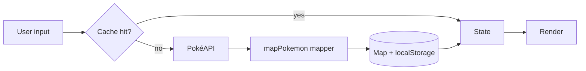

# Architecture — Pokédex Explorer

**Shape:** three static files — `index.html` (structure), `styles.css` (tokens + components), `app.js` (everything else). No build, no framework, no dependencies.

**Layers inside app.js:**
1. **API layer** — `fetchJson()` (throws typed errors with HTTP status), endpoint builders.
2. **Mapper layer** — `mapPokemon()` turns a raw payload into the exact UI shape (unit conversions, slot-sorted types, derived artwork URL). The DOM never sees raw API fields.
3. **State** — one `state` object: current page, total count, `listCache` (page → refs), `detailCache` (id → mapped Pokémon), active type + its member Set, mode (browse/search).
4. **Render** — pure DOM building from state; skeletons, cards, detail modal, states.

**Data flow:**

**Caching design:** details are immutable, so they are cached permanently (Map for the session, localStorage across visits, wrapped in try/catch for quota). Page reference lists are cached in memory only. Type member lists are cached in localStorage per type.

**Concurrency:** page loads and searches each own an `AbortController`. Detail fetches run through `fetchDetailsBatched()` — `Promise.all` in chunks of 12.
